 

<table>
<tr>
<td width="46%" valign="top"></td>
<td width="54%" valign="top"></td>
</tr>
</table>

 

  

<a href="https://rblxlabs.vercel.app/">website</a> &nbsp; / &nbsp;
<a href="https://www.linkedin.com/in/rahmat-hadinata-iet/">linkedin</a> &nbsp; / &nbsp;
<a href="mailto:rhnata25@gmail.com">email</a>

  

